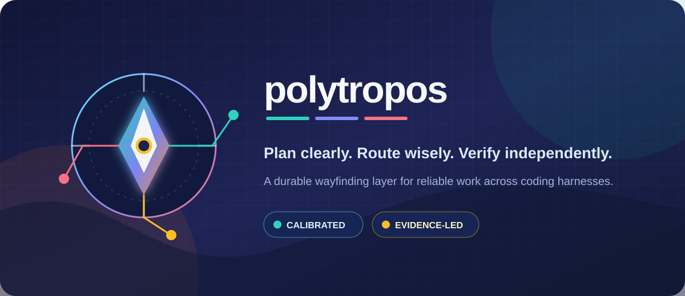
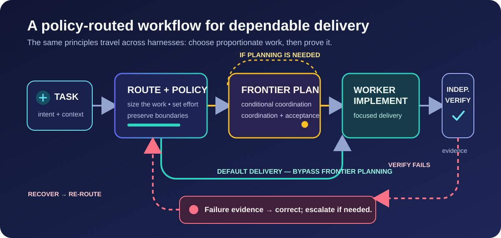

# polytropos

> *aesop tells the fables; polytropos finds the way.*

`CLAUDE CODE` · `GITHUB COPILOT CLI` · `CODEX CLI`

**Policy-guided routing** · **evidence-gated recovery** · **maintained documentation**

Polytropos is a cross-harness routing and workflow kit for coding agents. It helps you select an appropriate model before an expensive task, preserve a clear plan, and use independent verification with recovery based on evidence. Start in the CLI you already use.

## Start here

Choose one harness. Install paths and model rosters are intentionally separate; each has its own configuration and pricing data.

| Harness | Install | First useful action |
|---|---|---|
| **Claude Code** | `/plugin marketplace add /path/to/polytropos` `/plugin install polytropos@polytropos-local` CLI: `claude plugin marketplace add /path/to/polytropos` `claude plugin install polytropos@polytropos-local` | Run `/polytropos:route <task>` before a substantial task. |
| **GitHub Copilot CLI** | `python3 bin/harness_select.py detect` `python3 bin/harness_select.py install --harness copilot` | In Copilot, choose `/agent` → `route`, or run `copilot --agent route --prompt "<task>"`. |
| **Codex CLI** | `codex plugin marketplace add /path/to/polytropos` `codex plugin add polytropos@polytropos-local` | Open `/skills` and invoke `$route <task>`; do not rely on a bare `/route` alias. |

Claude Code can also use a one-off checkout with `claude --plugin-dir /path/to/polytropos`. Copilot’s installer refreshes only its unchanged managed files and preserves conflicting personal edits; use `--dry-run` to inspect destinations first. Codex packages are cached, so start a new task after installing. For Codex package preparation and optional project roles, use the [Codex harness guide](docs/CODEX-HARNESS.md).

Once installed, discover the workflows in your host: Claude uses `/polytropos:*` commands; Copilot uses `/skills reload`, `/skills list`, and `/agent` (a skill name is not a native slash command); Codex uses `/skills` and `$skill` invocations. Claude’s `/polytropos:setup` manages its own status line; Codex’s `$setup` configures the native Codex status line, while `$usage` reads local activity. The [Copilot installation guide](copilot-docs/INSTALL.md) and [Codex skill guide](docs/CODEX-HARNESS.md#skills-and-legacy-copies) explain the different discovery and setup paths.

## The workflow in one screen

Routine work can go straight from routing to a suitable worker. Complex work gets a planning pass; failed verification carries evidence into targeted recovery and another check. Routing is advice and a policy boundary, not a claim that every host dispatch is observed. Each harness records what it can know, keeps direct user-selected runs outside the policy boundary, and leaves unverified runtime facts marked as unknown.

## What you get

- A task-first router that compares suitable candidates and returns the next command.
- A plan → execute → independently verify loop for work that warrants it.
- Escalation that carries failure evidence instead of routinely starting at the most capable model.
- Local usage, freshness, graph-grounding, assessment, and benchmark-planning tools, with capability differences documented per harness.

The detailed mechanics, limits, and examples live in the [documentation site](https://agentmc15.github.io/polytropos/), [architecture guide](docs/HOW-IT-WORKS.md), and [complete guide & cookbook](docs/GUIDE.md). For harness-specific behavior, see [Claude skills](skills/), [Copilot CLI](docs/COPILOT-HARNESS.md), and [Codex CLI](docs/CODEX-HARNESS.md). Why this is spec-driven development — the architect writes the spec, pinned cheaper models execute it, verification is against the spec — is in [docs/SPEC-DRIVEN.md](docs/SPEC-DRIVEN.md). A guide to spec-driven development itself, mapped to polytropos and back, is in [docs/sdd/guide.md](docs/sdd/guide.md). The usual SDD pipeline beside polytropos's is in [docs/sdd/pipelines.md](docs/sdd/pipelines.md), and every guardrail, with the code that implements it, the test that proves it and the stage where it acts, is in [docs/sdd/guardrails.md](docs/sdd/guardrails.md); the [documentation site](https://agentmc15.github.io/polytropos/) carries all three.

Polytropos also has a [Cursor headless harness](docs/CURSOR-HARNESS.md). Its adapter and bundle are separate from the three quick starts above, and its usage remains unpriced where no rates are known.

## Skills at a glance

Every skill, the situation it is for, and the skills that usually go with it. A name links to that skill's page on the documentation site, which carries a worked example, failure modes, and cost notes. A skill missing from a harness is usually deliberate; the [parity matrix](https://agentmc15.github.io/polytropos/skills/) says why.

**Decide before you run**

| Skill | Harnesses | Use it when | Pairs well with |
|---|---|---|---|
| [route](https://agentmc15.github.io/polytropos/skills/claude/route/) | Claude · Copilot · Codex | Before anything expensive or long-running, to see which tier the task needs and what it will cost. | `fable-check`, `frontier-check`, `escalate`, `architect` |
| [fable-check](https://agentmc15.github.io/polytropos/skills/claude/fable-check/) | Claude | Route points at the frontier tier and you want a go/no-go, plus the effort level and task framing to run it well. | `route`, `escalate`, `architect` |
| [frontier-check](https://agentmc15.github.io/polytropos/skills/copilot/frontier-check/) | Copilot · Codex | The same question on those harnesses: does this task need the top tier, or will a strong or policy-selected worker do. | `route`, `escalate`, `architect` |
| [effort](https://agentmc15.github.io/polytropos/skills/copilot/effort/) | Copilot · Codex | The model is right but the reasoning level is not: raise it on evidence, lower it for routine work. | `route`, `escalate` |
| [bench-routing](https://agentmc15.github.io/polytropos/skills/claude/bench-routing/) | Claude · Copilot · Codex | Someone proposes moving a role to a newer or higher-tier model and you want that checked against published benchmarks and, where the ledger has them, this repository's own outcomes. | `repo-bench`, `route`, `execute` |
| [repo-bench](https://agentmc15.github.io/polytropos/skills/claude/repo-bench/) | Claude · Codex | You want models measured on this repository's own real work before re-tiering or picking a daily driver. Plan-only on Codex. | `bench-routing`, `route`, `execute` |

**Plan and build**

| Skill | Harnesses | Use it when | Pairs well with |
|---|---|---|---|
| [architect](https://agentmc15.github.io/polytropos/skills/claude/architect/) | Claude · Copilot · Codex | The work is big enough that one wrong early decision compounds: plan once at the top tier and get a kit cheaper models can run. | `execute`, `graphify`, `repo-bench` |
| [execute](https://agentmc15.github.io/polytropos/skills/claude/execute/) | Claude · Copilot · Codex | A kit exists and its tasks need dispatching, independent verification, and a record of what happened. | `architect`, `escalate`, `budget` |
| [escalate](https://agentmc15.github.io/polytropos/skills/claude/escalate/) | Claude · Copilot · Codex | One task with a machine-checkable outcome: try the cheapest sufficient model and climb only when the check fails. | `route`, `fable-check`, `frontier-check` |
| [goliath](https://agentmc15.github.io/polytropos/skills/copilot/goliath/) | Copilot | A single Copilot session should run the fullest multi-role review pipeline rather than the base trio. | `architect`, `execute` |
| [budget](https://agentmc15.github.io/polytropos/skills/copilot/budget/) | Copilot | AI Credits are the binding constraint on a kit of routine tasks whose verify commands are strong. | `execute`, `usage` |
| [graphify](https://agentmc15.github.io/polytropos/skills/claude/graphify/) | Claude · Codex | You need repository structure — callers, dependents, impact — before planning or after a change. Needs the external graphify CLI. | `architect`, `context-weight` |
| [assess-improvement](https://agentmc15.github.io/polytropos/skills/claude/assess-improvement/) | Claude · Codex | You want an evidence-backed answer to where a codebase could improve, with handoff briefs and nothing changed. | `architect`, `graphify` |
| [context-travel](https://agentmc15.github.io/polytropos/skills/claude/context-travel/) | Claude · Copilot · Codex | A kit task is explicitly identified and you want a bounded, read-only briefing on it, or a supplied briefing explained or two compared, instead of loading the kit, graph, or transcript into context. Needs an operator-supplied config; the briefing is advisory. | `execute`, `architect`, `route`, `escalate` |

**See what happened**

| Skill | Harnesses | Use it when | Pairs well with |
|---|---|---|---|
| [cost-report](https://agentmc15.github.io/polytropos/skills/claude/cost-report/) | Claude | You want what was actually spent, by model and session, and where a cheaper model would have sufficed. | `route`, `dashboard`, `journal` |
| [usage](https://agentmc15.github.io/polytropos/skills/copilot/usage/) | Copilot · Codex | The same look backward on those harnesses, read from their own local session logs. | `route`, `budget`, `journal` |
| [dashboard](https://agentmc15.github.io/polytropos/skills/claude/dashboard/) | Claude | You want one offline page over the attempt ledger, the routing scorecard, and telemetry before deciding what to check next. | `journal`, `cost-report`, `update` |
| [journal](https://agentmc15.github.io/polytropos/skills/claude/journal/) | Claude · Copilot · Codex | End of day: record what happened across harnesses and plan tomorrow. | `memory`, `cost-report`, `usage` |
| [context-weight](https://agentmc15.github.io/polytropos/skills/claude/context-weight/) | Claude · Copilot · Codex | The context window is heavy and you are deciding what to prevent, prune, or measure before compacting. | `graphify`, `execute` |
| [memory](https://agentmc15.github.io/polytropos/skills/claude/memory/) | Claude · Codex | A fact, preference, or correction should outlive the session, or you want one recalled under a budget. Recall and review only on Codex. | `journal` |
| [lessons-loop](https://agentmc15.github.io/polytropos/skills/copilot/lessons-loop/) | Copilot | Right after a correction or an escalation, and at session start to load what applies. | `route`, `execute`, `escalate` |

**Keep the install healthy**

| Skill | Harnesses | Use it when | Pairs well with |
|---|---|---|---|
| [setup](https://agentmc15.github.io/polytropos/skills/claude/setup/) | Claude · Codex | You want model, cost, and context visible in the status line. | `update`, `cost-report`, `usage` |
| [update](https://agentmc15.github.io/polytropos/skills/claude/update/) | Claude · Codex | After pulling changes, to check every harness install for drift; read-only until you ask for a refresh. | `setup`, `doctor` |
| [doctor](https://agentmc15.github.io/polytropos/skills/codex/doctor/) | Codex | A Codex skill is missing, stale, or pointing at an old plugin cache. | `update`, `setup`, `route` |

On Claude Code the effort dial is a session setting, and the guidance for it rides inside `route`. The [Cursor headless harness](docs/CURSOR-HARNESS.md) carries `assess-improvement` and its own kit driver outside this matrix. The same map, with the sequences these skills form, is on the site as [Choose a skill](https://agentmc15.github.io/polytropos/workflows/choose-a-skill/).

## Current model routes

These are **configuration snapshots** — Claude’s checked on 2026-10-07, Codex’s and Copilot’s on 2026-09-24 — not an automatic feed of new releases or a guarantee for every account. Each harness has its own pricing and model registry; public availability and your client’s picker can still differ. The links lead to the provider catalogs used for this refresh.

| Harness | Current Polytropos routes | Why an older model may still appear |
|---|---|---|
| **Claude Code** · [Anthropic lineup](https://platform.claude.com/docs/en/models/overview) | Fable 5.1 (frontier), Opus 5.5 (strong), Sonnet 5.5 (mid), Haiku 4.5 (cheap). Haiku 5.5 is priced but not yet the cheap-tier default. | Prior generations remain for historical estimates and explicit compatibility pins where the provider still supports them. |
| **Codex CLI** · [OpenAI lineup](https://developers.openai.com/api/docs/models) | GPT-6 Astra (reserved orchestration), GPT-6 Sol (strong work and verification), GPT-5.6 Terra (mid work), GPT-6 Luna (cheap work). | Terra remains the available mid-tier worker; older Sol/Luna entries are cost-only. |
| **GitHub Copilot CLI** · [GitHub CLI model support](https://docs.github.com/en/copilot/reference/ai-models/supported-models) | The curated roster now includes GPT-6 Astra/Sol/Luna, Claude Fable 5.1 and Opus 5.5, Gemini 3.8 Flash, MAI-Code-1.1-Flash, Grok 4.7, and Kimi K3 alongside retained models. | Published support alone does not grant an account access; check `/model` and your organization’s policies. Fable 5.1 has a [data-retention caveat](https://docs.github.com/en/copilot/reference/ai-models/supported-models). |

The canonical files are [Claude `data/pricing.json`](data/pricing.json), [Codex `data/pricing.codex.json`](data/pricing.codex.json), and [Copilot `data/pricing.copilot.json`](data/pricing.copilot.json). Rates, context thresholds, tier defaults, and availability notes belong there; a public catalog entry never silently becomes a routing target.

## Important security boundaries

> **Read this before unattended use.** On macOS, kit verification commands run inside an OS boundary (`bin/exec_policy.py`, `sandbox-exec`): writes are confined to the workspace, network access is denied, and credential stores are unreadable. This is the default and it refuses rather than silently downgrading.
>
> **Linux and Windows do not yet have a confinement backend.** Verification there requires the explicit `--exec-mode trusted-host`, which enforces nothing. Benchmark candidate and judge dispatch are not yet confined on any platform. Read [SECURITY.md](SECURITY.md) for the enforced scope, exclusions, and operating guidance.

The Codex repo-bench port is planning-only and structurally refuses live candidate and judge dispatch. A ChatGPT-plan dollar figure is an API-equivalent proxy, not an actual bill or a spend ceiling. The Copilot and Claude tools likewise label the limits and provenance of their own estimates—do not combine their pricing surfaces.

## Keep going

- [Manual documentation site](https://agentmc15.github.io/polytropos/) — maintained, cross-harness reference.
- [Full reference](docs/REFERENCE.md) — every model, role, skill, engine and harness on one long page.
- [How it works](docs/HOW-IT-WORKS.md) — architecture and policy rationale.
- [Guide & cookbook](docs/GUIDE.md) — skill reference and worked examples.
- [Copilot documentation center](copilot-docs/README.md) — task-oriented Copilot material.
- [Release support matrix](docs/RELEASE.md) — verified versus unknown capability status.
- [Update skill](skills/update/SKILL.md) — read-only freshness check before a refresh.

Polytropos is named for the “many-wayed” Odysseus: use the smallest capable path, keep the evidence, and make the exceptional path explicit.
