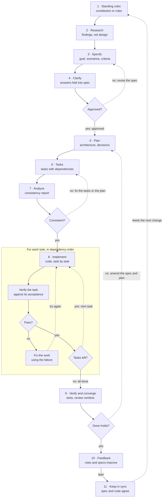
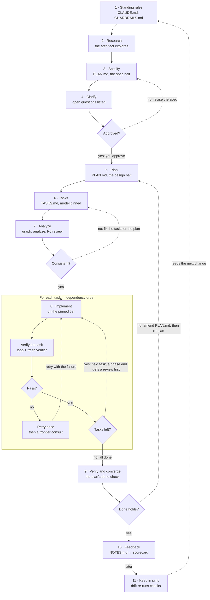

# The usual SDD pipeline, and polytropos's

*polytropos · spec-driven development · two pipelines*

Part 1 walks through spec-driven development: the stages every spec-driven tool shares, what each
one produces, and the gates between them. Part 2 walks through the same stages as polytropos runs
them. Part 3 puts the usual AI pipeline beside polytropos's and compares the two.

This is the Markdown form of [docs/sdd/pipelines.html](pipelines.html), which draws the charts as
SVG. Here they are Mermaid diagrams: GitHub renders them, and other viewers show their source.

- **Part 1:** [Spec-driven development](#spec-driven-development)
- **Part 2:** [polytropos](#polytropos)
- **Part 3:** [Side by side](#side-by-side)

---

**Part 1**

## Spec-driven development

Spec-driven development writes down what to build, and why, before any code, and then checks the
code against that spec. Every spec-driven tool walks the same stages under different names. Each
stage produces an output and ends at a *gate*: what must be true before the next stage starts.

### The stages

Stages 1 to 10 follow the lifecycle table in [docs/sdd/guide.md](guide.md), and stage 11 is its
principle P8.

| # | Stage | What it is | Output | Gate |
|---|---|---|---|---|
| 1 | Standing rules | Constraints every change obeys, set once for the whole project. | a constitution or rules file | exists before the first change |
| 2 | Research | Map the problem and the existing code before deciding anything. | findings, not design | the findings are reviewed |
| 3 | Specify | What to build and why, without design. | the goal, scenarios, acceptance criteria and what is out of scope | a person approves it |
| 4 | Clarify | Surface ambiguity while it is still cheap to fix. | questions and answers, folded back into the spec | no open question would change the plan |
| 5 | Plan | How to build it, with the reasons. | the architecture, the decisions and the risks | consistent with the standing rules |
| 6 | Tasks | Break the plan into ordered, checkable work. | a task list with the dependencies between tasks | every task traces to the plan |
| 7 | Analyze | Check the spec, plan and tasks against each other before anything is built. | a consistency report | no contradiction or gap |
| 8 | Implement | Build against the tasks, one task at a time. | code, task by task | each task verified |
| 9 | Verify and converge | Prove the whole matches the spec, not just each piece. | test results and review verdicts | the spec's "done" holds |
| 10 | Feedback | Learn from the run. | updated rules, and better specs next time | recorded where the next planner reads it |
| 11 | Keep in sync | After the change ships, check that the spec and the code still agree. | tests that tie the spec to the code, often run in CI | drift is detected, not discovered |

### The flow, with its gates

The same stages as a flow chart. A diamond is a gate: *yes* moves the work on, and *no* sends it
back along a dotted arrow. The second line in each box is that stage's typical output.

A change runs from the top. The spec is approved, the plan and tasks pass a consistency check, each
task is built and verified in turn, and the whole is checked against the spec's "done".

---

**Part 2**

## polytropos

`/polytropos:architect` plans a change once, on the frontier tier, and writes an execution kit:
`PLAN.md`, `TASKS.md` and `GUARDRAILS.md`. `/polytropos:execute` runs the kit, sending each task to
the cheapest tier that can do it and checking every result. Here are the same stages again, as
polytropos runs them.

### Each stage in polytropos

The numbers match Part 1. The last column says where the behavior is defined.

#### Before the run · the architect, on the frontier tier

| # | Stage | In polytropos | Where |
|---|---|---|---|
| 1 | Standing rules | `CLAUDE.md` holds always-on invariants, many enforced by tests. The architect writes each kit's `GUARDRAILS.md`, rules for that change only, and the run re-reads it from disk at every phase start. | the repo's `CLAUDE.md`; the kit's `GUARDRAILS.md` |
| 2 | Research | The architect explores before planning, optionally grounded in a code graph with `bin/graph_ground.py`. A `scout` role is available. | `skills/architect/SKILL.md` |
| 3 | Specify | The spec half of `PLAN.md`: a goal, a checkable "done", constraints and an out-of-scope fence. The architect writes nothing to disk until you approve it. | `skills/architect/SKILL.md`, Step 1 |
| 4 | Clarify | Scoping questions before the frontier run, then assumptions and open questions listed under the spec draft, for you to settle at the approval pause. | `skills/architect/SKILL.md`, Steps 0–1 |
| 5 | Plan | The design half of `PLAN.md`: decisions with rationale, risks with tripwires, and optional `autonomy:`, `budget:`, `roles:` and `workflow:` lines. | `skills/architect/SKILL.md`, Step 1 |
| 6 | Tasks | `TASKS.md`: per task an id, a pinned `model`, a self-contained brief, acceptance, a verify command, an `evidence:` rule and its `depends:`. | `skills/architect/SKILL.md`, Step 2 |

#### The run · the execute loop

| # | Stage | In polytropos | Where |
|---|---|---|---|
| 7 | Analyze | `kit_contract.py graph` rejects duplicate ids, unknown dependencies and cycles. `analyze` checks the paths each brief names and whether each verify command can run, without running anything. Then, in an interactive run, one opus spec review looks for contradictory acceptance and uncovered goals. | `bin/kit_contract.py`; `skills/execute/references/spec-review.md` |
| 8 | Implement | Each task goes to the implementer on its pinned tier, with its brief and nothing else; the implementer stops and reports if the brief is wrong. The loop then runs the verify command itself, and a check that already passed before the work blocks the task. | `skills/execute/SKILL.md` |
| 9 | Verify and converge | A fresh-context verifier re-checks each task, joined by a test-author and red-team when the kit declares them. A failure gets one retry, then a frontier consult. An opus reviewer checks each phase against `PLAN.md`, and once `kit_contract.py graph` reports every task done, the plan's done check runs. | `skills/execute/SKILL.md` |

#### After the run

| # | Stage | In polytropos | Where |
|---|---|---|---|
| 10 | Feedback | `outcome:`, `agent:`, `reviewer:` and `defect:` lines in `NOTES.md`, and an acceptance record from `accept` for each passing task. `bin/routing_scorecard.py` grades the tiers, the review roles and the briefs, and the next architect reads it. | `skills/execute/references/ledger.md` |
| 11 | Keep in sync | `kit_contract.py drift` re-runs a finished kit's verify commands inside the execution boundary and reports drift, not failure. Within a kit, `freshness` marks a finished task stale when work it relied on is re-accepted, and `refresh` re-verifies it. A check that starts its own sandbox reads drifted, a known limit. | `bin/kit_contract.py` |

### The flow in polytropos

The same flow, with the part of polytropos that does each stage named on the second line of its
box. Two paths are polytropos's own: a failed task gets one retry and then a frontier consult, and
a "done" that does not hold sends the work back to amend `PLAN.md`.

---

**Part 3**

## Side by side

The left column of the HTML page is how most AI spec-driven tools run a change; the right column is
how polytropos runs one. Here they follow one another. Both start from a written spec. The
difference is in who checks the work, which model does each part, and what happens to what was
learned. The italic label on each step says who does it: a person, the frontier tier (fable),
opus, or sonnet and haiku.

### Typical AI spec-driven development

The common shape of tools such as Spec Kit and Kiro, simplified. Individual tools add steps, such
as clarify, analyze, checklists, hooks or converge.

1. **Standing rules** · *once per project*. A constitution or rules file the agent reads as
   context.
   - **Gap:** rules are context, not enforced; nothing fails when one is broken.
2. **Specify** · *you + the agent*. What to build and why: stories, scenarios, acceptance criteria.
3. **Plan** · *the agent*. The technical approach and design documents.
4. **Tasks** · *the agent*. An ordered task list, some marked parallel.
   - **Gap:** no model choice per task; one model does everything.
5. **Implement** · *the same agent, same model*. Works through the task list, writing code and
   tests.
6. **Verify** · *the same agent*. Runs the tests it wrote and reports the result.
   - **Gap:** the builder grades its own work; Anthropic found agents "reliably skew positive"
     doing so.
7. **Done** · *after the change*. The spec is set aside, or kept but not re-checked.
   - **Gap:** drift goes unnoticed, and nothing records whether the spec itself was wrong.

### polytropos

`/polytropos:architect` writes an execution kit once; `/polytropos:execute` runs it. The source of
each step is named in `skills/architect/SKILL.md` and `skills/execute/SKILL.md`.

1. **Standing rules, enforced** · *always on, plus per kit*. `CLAUDE.md` invariants backed by
   tests, plus the kit's own `GUARDRAILS.md`, re-read from disk at every phase start.
   - **Check:** many invariants fail the test suite when broken.
2. **Spec** · *fable, once*. The architect drafts the goal, a checkable "done", constraints and an
   out-of-scope fence.
3. **Approval pause** · *you, a gate*. Nothing is written to disk until you approve the spec.
4. **Design and tasks** · *fable, once*. Decisions with reasons, risks with tripwires, and per task
   a self-contained brief, acceptance, a verify command, an `evidence:` rule and a pinned model.
   - **Check:** every task names its proof and its price.
5. **Pre-run check** · *before any dispatch*. `kit_contract.py analyze` checks paths and verify
   commands without running anything; then one opus spec review for contradictions and uncovered
   goals, skipped for `workflow: direct` kits.
6. **For each task:**
   1. **Implementer** · *haiku / sonnet / opus, as pinned*. Builds from the brief alone; stops and
      reports if the brief is wrong.
   2. **Verify, red-green** · *the loop, not the builder*. The orchestrator runs the verify command
      itself. A check that already passed before the work blocks the task.
   3. **Independent verifier** · *sonnet, fresh context*. Re-checks acceptance against the files,
      plus a test-author and red-team when the kit declares them.
      - **pass:** marked done; the outcome goes in the ledger.
      - **fail:** one retry with the failure; then a fable consult carrying only the evidence.
7. **Phase review** · *opus, each phase end*. Checks the phase against `PLAN.md` for drift before
   the next phase starts.
8. **Ledger** · *every outcome, dispatch and review*. `NOTES.md` lines that record what passed,
   what each reviewer found, and which briefs were wrong (`defect:`). `accept` also records each
   acceptance.
9. **Drift check** · *after the change*. `kit_contract.py drift` re-runs a finished kit's checks
   against today's code and reports drift, without marking anything failed.
10. **Scorecard** · *across every kit*. `bin/routing_scorecard.py --history` grades the tiers, the
    review roles and the briefs.
    - ↺ read by the next architect before it writes the next spec.

### What changes

| Question | Typical AI SDD | polytropos |
|---|---|---|
| Who approves the spec? | You, usually informally | You, at an explicit pause before any design |
| Which model builds each part? | One model throughout | The frontier tier plans once; each task is pinned to the cheapest tier that can do it |
| Who decides the work is done? | The agent that built it | The loop runs the check, and a fresh-context verifier and a phase reviewer judge it |
| Can a check that proves nothing pass? | Yes | No: the red-green rule blocks a check that already passed before the work |
| What if the spec is wrong? | The agent works around it | The task stops and reports, and the defect is recorded by kind |
| Is the spec checked before spending anything? | Some tools have an analyze step | `analyze` and a spec review, both before the first dispatch |
| Is it re-checked after the change ships? | Rarely | `drift`, a re-run of a finished kit's checks inside the execution boundary |
| Does the next spec learn from this one? | No record | The scorecard's defect kinds and tier and role history feed the next architect |

---

Long form: [docs/sdd/guide.md](guide.md) and [docs/SPEC-DRIVEN.md](../SPEC-DRIVEN.md) · HTML form:
[docs/sdd/pipelines.html](pipelines.html) · Source: github.com/agentmc15/polytropos
